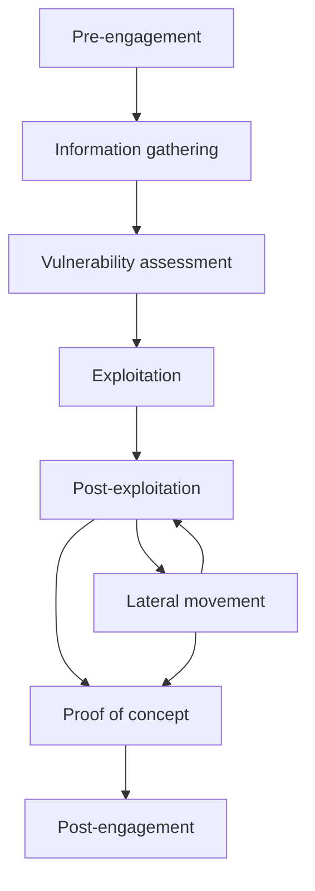

# Penetration Testing Process

> Source: HTB Academy — Penetration Tester Path  
> Purpose: Study notes and engagement reference

## Core Idea

A penetration test is a sequence of connected activities used to find a path to an agreed objective. The process is structured, but it is not a rigid recipe. Every engagement has a different scope, environment, risk tolerance, and target, so testers must adapt their techniques to the evidence they discover.

The eight stages provide a decision framework:

1. Pre-engagement
2. Information gathering
3. Vulnerability assessment
4. Exploitation
5. Post-exploitation
6. Lateral movement
7. Proof of concept
8. Post-engagement

Later technical stages are often iterative. New information found during exploitation or post-exploitation can send the tester back into enumeration and vulnerability analysis.

## Engagement Flow

The arrows show the typical progression, not mandatory one-way gates. Authorization, scope, and rules of engagement govern every stage.

## The Eight Stages

### 1. Pre-Engagement

Define and authorize the assessment before testing begins.

Key items:

- Non-disclosure agreement
- Business and technical objectives
- In-scope and out-of-scope systems
- Permitted and prohibited techniques
- Testing window and time estimate
- Rules of engagement
- Emergency contacts and stop conditions
- Evidence handling and retention
- Deliverables and retest expectations

The signed agreement is the tester's authorization boundary. A discovered system is not automatically in scope.

### 2. Information Gathering

Build an accurate picture of the target and its attack surface.

Typical activities:

- Passive reconnaissance
- DNS, domain, and public-footprint research
- Host and port discovery
- Service and version enumeration
- Web technology fingerprinting
- Application and identity-flow mapping
- Understanding normal system behavior

Good enumeration reduces guesswork during later stages. Record both positive and negative results.

### 3. Vulnerability Assessment

Analyze enumeration results to identify and validate possible weaknesses.

Consider:

- Known vulnerabilities associated with observed versions
- Misconfigurations and insecure defaults
- Authentication and authorization weaknesses
- Exposed administrative interfaces
- Business-logic flaws
- Chained weaknesses that may be low risk individually

Automated scanners produce leads, not proof. Manually validate findings, account for environmental conditions, and eliminate false positives.

### 4. Exploitation

Safely test validated attack vectors to obtain the agreed level of access or demonstrate impact.

Before execution:

- Reconfirm scope and authorization
- Understand the exploit's behavior and side effects
- Prefer the least destructive validation method
- Prepare evidence collection and rollback steps
- Observe rate, availability, and safety restrictions

Success means proving a weakness and its impact—not causing unnecessary disruption.

### 5. Post-Exploitation

Determine what the obtained access makes possible.

Common objectives:

- Local enumeration
- Privilege escalation
- Credential and secret discovery
- Sensitive-data discovery
- Security-control and trust-relationship analysis
- Impact validation

Persistence is not automatically appropriate. Only establish it when the rules of engagement explicitly authorize it, and use a controlled, removable mechanism.

### 6. Lateral Movement

Use information and access from one system to reach other authorized systems.

Typical cycle:

1. Enumerate the compromised host and its trust relationships.
2. Identify credentials, sessions, keys, shares, and reachable services.
3. Test reuse or delegated access within scope.
4. Access the next host.
5. Repeat post-exploitation and enumeration.

Lateral movement and post-exploitation commonly form an iterative loop. Maintain a clear attack-path record so each transition can be explained and reproduced.

### 7. Proof of Concept

Document reproducible evidence showing that the vulnerability and attack path exist.

A useful proof of concept includes:

- Preconditions and required privileges
- Affected host, service, endpoint, or component
- Exact reproduction steps
- Sanitized requests, commands, screenshots, or logs
- Observed result
- Business and technical impact
- The relationship between chained findings
- Safe remediation guidance

Scripts may help reproduce a finding, but they should be minimal, safe, and delivered only when appropriate.

### 8. Post-Engagement

Conclude the technical work and transfer useful results to the client.

Activities include:

- Remove test accounts, payloads, files, persistence, and configuration changes
- Verify cleanup
- Complete technical and executive reports
- Assign severity and remediation priority
- Conduct the report walkthrough or executive presentation
- Securely archive or destroy engagement data according to the agreement
- Perform a remediation retest when contracted

## Stage Outputs

| Stage | Primary output |
|---|---|
| Pre-engagement | Signed authorization, scope, objectives, and rules |
| Information gathering | Target and attack-surface inventory |
| Vulnerability assessment | Prioritized, validated attack hypotheses |
| Exploitation | Evidence of access or demonstrated impact |
| Post-exploitation | Privilege, data-access, and host-impact analysis |
| Lateral movement | Documented attack paths between systems |
| Proof of concept | Reproducible evidence and vulnerability chain |
| Post-engagement | Reports, cleanup confirmation, and retest plan |

## Documentation Discipline

Document continuously rather than reconstructing the engagement at the end.

For each meaningful action, record:

- Timestamp and tester
- Source and target
- Tool, command, or request
- Result and interpretation
- Evidence location
- Scope and safety considerations
- Files or changes that require cleanup

Sanitize credentials, tokens, personal data, and customer information before including evidence in reports.

## Key Distinctions

| Concept | Meaning |
|---|---|
| Process | Flexible sequence directed toward an agreed objective |
| Stage | Broad category of work within the process |
| Playbook | Reusable collection of techniques and checks for a situation |
| Procedure | More specific sequence for performing an activity |
| TTP | A tactic, technique, or procedure describing adversary/tester behavior |
| Vulnerability scan | Automated identification of potential weaknesses |
| Penetration test | Human-led validation and chaining of weaknesses to demonstrate risk |

## Practical Lessons

- Scope governs every action, including newly discovered assets.
- Enumeration continues throughout the engagement.
- Tool output is evidence to investigate, not an automatic finding.
- Prefer safe validation over maximum exploitation.
- Record attack-path dependencies, not just isolated vulnerabilities.
- A technically successful test with poor evidence produces limited value.
- Cleanup and data handling are part of the engagement, not optional administration.
- The report must help both engineers remediate and leadership understand business risk.

## Quick Recall

**Lifecycle:** Plan → Discover → Assess → Exploit → Expand → Prove → Report.

**Core principle:** The process is structured enough to prevent missed responsibilities and flexible enough to adapt to each environment.

