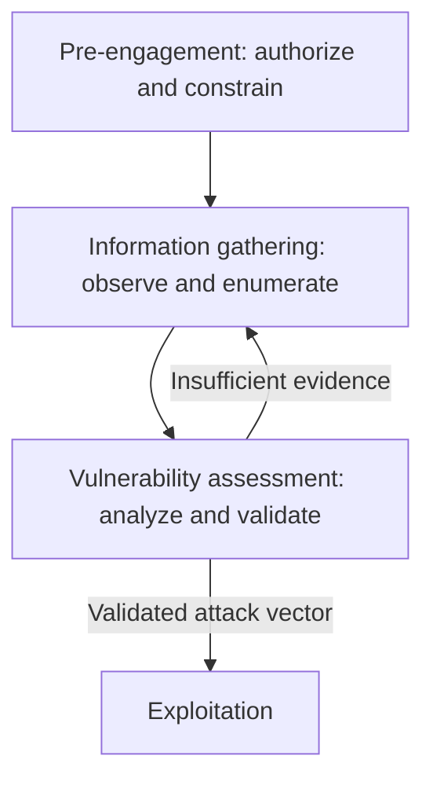

# Pre-Engagement, Information Gathering, and Vulnerability Assessment

> Source: HTB Academy — Penetration Tester Path  
> Purpose: Study notes and engagement methodology

## How the Three Stages Connect



- **Pre-engagement** determines what may be tested, how, when, and by whom.
- **Information gathering** establishes what exists and how it behaves.
- **Vulnerability assessment** turns observations into tested security hypotheses.

Information gathering and vulnerability assessment repeatedly feed each other. A real penetration test values complete, defensible coverage over the speed-oriented flag hunting common in CTFs.

---

# 1. Pre-Engagement

## Purpose

Pre-engagement establishes authorization, objectives, scope, safety limits, communications, and deliverables before technical testing begins. It normally contains three major activities:

1. Scoping questionnaire
2. Pre-engagement meeting
3. Kick-off meeting

Confirm that the person commissioning the test has authority to do so. A request from an employee is not sufficient proof that the organization has authorized testing.

## Confidentiality Agreements

| NDA type | Parties bound to confidentiality |
|---|---|
| Unilateral | One party |
| Bilateral | Both parties; common for penetration tests |
| Multilateral | More than two parties; useful for joint environments |

An NDA protects confidential information, but it does not replace written authorization to test.

## Core Documents

| Document | Typical purpose |
|---|---|
| NDA | Protect confidential information |
| Scoping questionnaire | Collect initial size, type, and objective information |
| Scoping document | Consolidate the systems and activities under consideration |
| Proposal / contract / SoW | Define services, responsibilities, schedule, cost, and deliverables |
| Rules of Engagement (RoE) | Define exactly how testing may be performed |
| Physical-assessment authorization | Prove authorization during physical or social-engineering testing |
| Reports | Communicate interim alerts, evidence, impact, and remediation |

Contracts and authorization documents should be reviewed by qualified legal counsel for the relevant jurisdiction.

## Scoping Questionnaire

The questionnaire identifies what service the client needs and provides enough detail to estimate time, staffing, infrastructure, and cost.

Possible assessment types:

- Internal or external vulnerability assessment
- Internal or external penetration test
- Web, mobile, or application security assessment
- Wireless security assessment
- Active Directory assessment
- Social engineering assessment
- Physical security assessment
- Red-team assessment
- Secure code review

Sizing questions may cover:

- Expected live hosts and IP/CIDR ranges
- Domains and subdomains
- Web or mobile applications and authenticated roles
- Wireless SSIDs
- Physical locations
- Phishing population and whether OSINT is permitted
- Internal starting access and test accounts
- Network Access Control testing
- Third-party infrastructure

## Knowledge and Evasiveness Models

| Model | Tester starting knowledge |
|---|---|
| Black box | Little or no internal information |
| Grey box | Limited information, credentials, or scope data |
| White box | Detailed architecture, source, configurations, and/or credentials |

Testing may be:

- **Non-evasive:** detection is acceptable or desired.
- **Hybrid-evasive:** begin quietly and increase activity to evaluate detection thresholds.
- **Fully evasive:** minimize detection within explicitly authorized limits.

Evasion never expands scope or overrides safety restrictions.

## Pre-Engagement Meeting Checklist

- Verify NDA status and contracting authority.
- Define business and technical goals.
- List precise in-scope and excluded targets.
- Select assessment type and methodology.
- Define testing locations and connection method.
- Establish dates, hours, and phase-specific windows.
- Obtain written third-party authorization when applicable.
- Define permitted evasive behavior.
- Explain risks such as alerts, lockouts, degraded service, or data changes.
- Identify critical systems and prohibited techniques.
- Define information handling and regulatory constraints.
- Record primary, secondary, and emergency contacts.
- Agree on communication channels and status cadence.
- Define report audiences, format, severity model, and retest terms.
- Establish payment and contractual terms.

## Rules of Engagement

The RoE converts expectations into operational controls. It should include:

- Purpose, goals, and measurable objectives
- Authorized testers and client representatives
- Exact IPs, CIDRs, domains, URLs, accounts, facilities, and applications
- In-scope and prohibited activities
- Start/end dates and permitted hours
- Test location, source IPs, VPNs, and test infrastructure
- Methodologies and assessment type
- Evidence, credential, and data-handling requirements
- Backup and restoration expectations
- Stop conditions and emergency escalation
- Critical-finding notification procedure
- Status meetings and communication channels
- Reporting and retest requirements
- Liability limitations and written permission to test

If a newly discovered asset is not listed or clearly covered, pause and obtain written clarification before testing it.

## Kick-Off Meeting

The kick-off confirms that the documents and operational reality agree.

Discuss:

- Participants and escalation order
- Testing start confirmation
- Scope and exclusions
- Source IPs and connectivity
- Monitoring expectations
- Account-lockout and availability risks
- Critical-finding notification
- Stop-work conditions
- Whether defenders know about the assessment
- Support availability during the test

Denial-of-service testing is normally excluded unless specifically authorized. Pause and escalate according to the RoE if testing causes instability, exposes an active compromise, encounters illegal material, or discovers a critical issue requiring immediate action.

## Physical Assessments

Physical and social-engineering testing requires explicit authorization that identifies:

- Authorized testers
- Facilities, buildings, floors, and rooms
- Dates and hours
- Permitted pretexts and physical actions
- Prohibited areas and safety restrictions
- Verification and emergency contacts
- Evidence handling

An authorization letter reduces legal ambiguity, but it is not literally a universal “get out of jail free card.” Local law and the exact scope still apply.

## Environment Preparation

Before testing:

- Patch and snapshot testing systems.
- Configure VPN, VPS, and callback infrastructure.
- Separate client data by engagement.
- Enable encrypted evidence storage.
- Synchronize system time.
- Prepare note-taking and command logging.
- Validate tool behavior in a lab.
- Define cleanup tracking.

---

# 2. Information Gathering

## Purpose

Information gathering builds the attack-surface model on which every later decision depends. It is not a one-time phase; enumeration continues throughout exploitation, post-exploitation, and lateral movement.

The four principal categories are:

1. Open-source intelligence
2. Infrastructure enumeration
3. Service enumeration
4. Host enumeration

## Open-Source Intelligence

OSINT uses publicly accessible sources to identify assets, people, technologies, dependencies, and exposed information.

Possible sources:

- DNS and certificate transparency records
- Search engines and archived pages
- Corporate sites and public documents
- Job advertisements
- Social media
- Code and package repositories
- Breach information available through lawful, authorized sources
- Technology and cloud-footprint databases

Potential findings include domains, email patterns, usernames, software versions, cloud resources, credentials, API tokens, private keys, internal names, and document metadata.

Handle discovered secrets as sensitive evidence. Do not use them automatically; follow the RoE and critical-finding notification process.

## Infrastructure Enumeration

Map the client's external or internal infrastructure and reconcile discoveries with scope.

Identify:

- IP ranges and autonomous-system information
- DNS and name servers
- Mail, web, VPN, and identity infrastructure
- Cloud-hosted assets
- Firewalls, WAFs, proxies, and load balancers
- Network segmentation and reachable subnets
- Unknown or shadow assets

A discovered asset must be checked against the authorized scope before active probing.

## Service Enumeration

For every reachable service, determine:

- Protocol and transport
- Listening port
- Service and product
- Version or build where reliable
- Authentication method
- Supported features and security controls
- Application purpose
- Information disclosed through banners, errors, or behavior

Do not equate a port number with a service. Services can run on nonstandard ports, and banners can be absent or misleading. Confirm through protocol-aware interaction.

## Host Enumeration

Build a profile for each in-scope host:

- Operating system and probable version
- Hostname, domain, and role
- Exposed and local-only services
- Service versions and configurations
- Users, groups, sessions, and privileges when authorized
- Network interfaces, routes, and trust relationships
- Installed applications and scheduled tasks
- Sensitive files, scripts, credentials, and configuration data

Internal systems are not inherently secure because they are unreachable from the internet. Weak configurations frequently persist behind perimeter controls.

## Pillaging

Pillaging is targeted information collection after access has been obtained. It supports privilege escalation, impact analysis, and lateral movement; it is not a standalone phase.

Examples:

- Credentials, keys, tokens, and password stores
- Configuration and history files
- Local databases and application data
- Shares, scripts, backups, and deployment files
- User, customer, or business-sensitive data
- Network and trust information

Collect only what is necessary to demonstrate impact. Avoid bulk extraction unless explicitly required and authorized.

## Enumeration Record

For each asset, maintain:

| Field | Example |
|---|---|
| Asset | `10.10.10.25` / `portal.example.test` |
| Scope status | In scope / pending confirmation / excluded |
| Host role | Web, database, domain controller, workstation |
| Port/protocol | `2121/tcp` |
| Observed service | Unknown banner; FTP-like behavior |
| Evidence | Scan output, response, screenshot, packet capture |
| Confidence | Confirmed / probable / hypothesis |
| Next action | Protocol probe, version detection, configuration review |

---

# 3. Vulnerability Assessment

## Purpose

Vulnerability assessment analyzes enumeration evidence to identify, research, and validate possible attack vectors. It converts observations into hypotheses and then attempts to confirm or disprove them safely.

## Four Useful Analysis Modes

| Analysis | Pentesting question |
|---|---|
| Descriptive | What did we observe? |
| Diagnostic | Why does it behave this way? |
| Predictive | What is likely to happen if we test this condition? |
| Prescriptive | What action should be taken to validate or remediate it? |

Keep facts, assumptions, and unknowns separate.

## Example: TCP Port 2121

Observation: TCP port `2121` is open, but the initial scan did not identify the service.

Reasoning:

- TCP tells us the service uses a connection-oriented transport.
- Port 2121 is outside the well-known `0–1023` range.
- Its resemblance to FTP's default port 21 creates a hypothesis—not a conclusion.
- A slow banner may cause ordinary version-detection probes to time out.

Safe validation examples:

```bash
nc -nv <target> 2121
ftp <target> 2121
nmap -sV -p2121 --version-all --min-rtt-timeout 15s <target>
```

Adjust timing only when evidence supports it. Aggressive timeouts may make scans unnecessarily slow, while overly short values may miss delayed services.

## Vulnerability Research

Research the exact product, version, configuration, platform, and exposure conditions using authoritative or reputable sources:

- Vendor security advisories
- CVE Program records
- NIST NVD
- CISA Known Exploited Vulnerabilities catalog
- Exploit Database
- Packet Storm
- Maintainer repositories and release notes

A version match does **not** prove vulnerability. Consider:

- Backported security patches
- Distribution-specific builds
- Disabled or unreachable vulnerable features
- Required authentication or privileges
- Platform and architecture differences
- Configuration prerequisites
- Compensating controls

## Proof-of-Concept Review

Before running public exploit code:

1. Read and understand the code.
2. Identify network callbacks, payloads, file writes, and destructive behavior.
3. Verify the affected versions and prerequisites.
4. Remove unnecessary payloads and unsafe actions.
5. Test in a lab that mirrors the target where practical.
6. Reconfirm authorization and operational risk.
7. Capture evidence and prepare rollback or cleanup.

Never treat exploit code as trustworthy merely because it is public or associated with a CVE.

## Local Replication

When stealth, safety, or availability is important, reproduce the target configuration in a lab using the information gathered. Local testing can help determine:

- Whether a vulnerability is reachable
- What the exploit changes
- Which indicators it produces
- Whether it can crash or corrupt the service
- What customization is required

The laboratory may not perfectly represent production, so final conclusions must state any uncertainty.

## Validate, Do Not Merely Scan

For each candidate finding:

- Confirm the asset and affected component.
- Reproduce the condition safely.
- Record preconditions and required privileges.
- Determine realistic impact.
- Check whether controls prevent exploitation.
- Eliminate false positives.
- Preserve evidence.
- Assign severity in the client's business context.

Automated scanning is one input to analysis. A scanner result becomes a reportable vulnerability only after adequate validation or clearly documented evidence and limitations.

## When to Return to Enumeration

Return to information gathering when:

- The service or version remains uncertain.
- Exploit prerequisites are unknown.
- Results conflict with the original hypothesis.
- Authentication or configuration details are missing.
- No credible vector is found.
- A new host, port, account, trust relationship, or application appears.

## Real Penetration Test vs. CTF

| Real penetration test | CTF / lab |
|---|---|
| Written authorization and business scope | Predefined game environment |
| Coverage, safety, and evidence matter | Speed and flags often dominate |
| False positives must be resolved | Intended vulnerabilities usually exist |
| Availability and data protection matter | Targets are designed to be attacked |
| Findings require business context | Success is usually technical |
| Cleanup and reporting are mandatory | Resetting the lab may be sufficient |

**Core lesson:** A real penetration test is not a CTF. Missing a simple, in-scope attack path because enumeration was rushed is a serious quality failure.

---

# Field Checklist

## Before Testing

- [ ] Verify contracting authority and written permission.
- [ ] Confirm scope, exclusions, source IPs, dates, and hours.
- [ ] Review prohibited techniques and stop conditions.
- [ ] Verify third-party permissions.
- [ ] Confirm contacts and secure communications.
- [ ] Prepare encrypted evidence storage and cleanup tracking.

## During Enumeration

- [ ] Reconcile every discovered asset with scope.
- [ ] Perform OSINT, infrastructure, service, and host enumeration.
- [ ] Record facts, confidence, unknowns, and next actions.
- [ ] Handle discovered secrets under the RoE.
- [ ] Continue enumeration after every new foothold.

## During Vulnerability Assessment

- [ ] Separate observations from hypotheses.
- [ ] Research vendor advisories and environmental prerequisites.
- [ ] Inspect exploit code before execution.
- [ ] Validate safely and remove false positives.
- [ ] Return to enumeration when evidence is incomplete.
- [ ] Document impact and business relevance.

